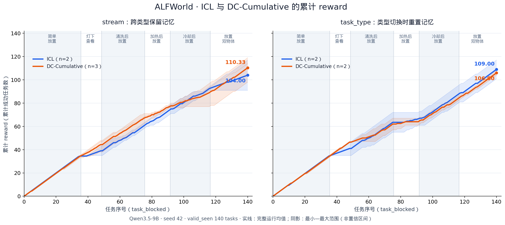
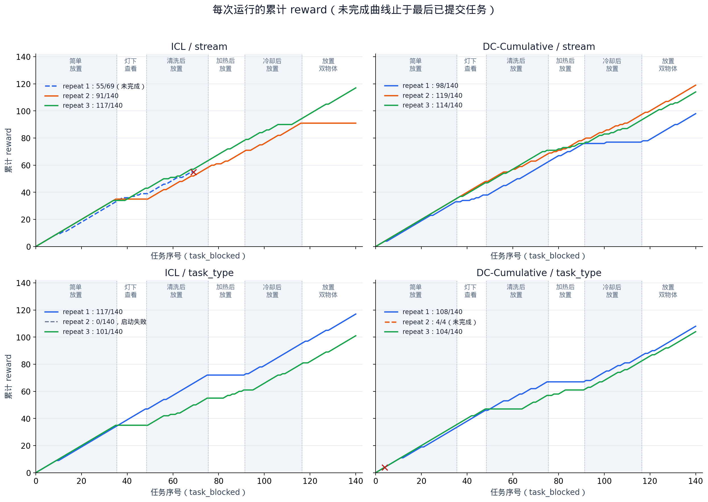

# ICL 与 DC-Cumulative：task_blocked 结果分析

最新：[加入 Success-only SFT 的五方法合图（英文图例）](five_methods_seed42_stream.md) · [SFT 更新数据来源](success_only_sft_training_sources.md)。

新增：[ICL、DC、Memoryless、ASCENT 四方法合图（seed 42 / stream）](four_methods_seed42_stream.md)。

生成时间：2026-11-05T09:13:25.978108+00:00。数据来自本机已提交实验记录。

## 累计 reward 折线图

横轴是任务执行序号 1–140，按 task_blocked 顺序排列；纵轴为前 t 个任务的终局 reward 之和：`R(t) = sum(score_i, i=1..t)`。已逐条核对日志：score 为 0/1 且等于 success，因此累计 reward 等于累计成功任务数。不是累计成功率，也不是每一步环境 score 的累加。

两幅子图分别比较 stream 和 task_type；粗线是完整运行的均值，细线是各次完整运行，阴影为这些重复运行的最小–最大值，不是置信区间。只纳入完整跑完 140 局的运行，因此每条均值曲线的 n 从头到尾不变。未完成运行不会补零、外推或在中途退出均值计算。

任务区间：简单放置 1–35；灯下查看 36–48；清洗后放置 49–75；加热后放置 76–91；冷却后放置 92–116；双物体放置 117–140。竖虚线标注类型边界。

## 设置与统计范围

- 模型 Qwen3.5-9B，valid_seen，admissible 动作模式，max_steps=50。所有运行均为 seed 42；repeat 编号不代表不同 seed。任务 manifest 和逐局任务 ID 已核对一致。
- ICL 使用前 3 局完整轨迹加当前局（window_episodes=4），不筛选前局是否成功。DC-Cumulative 每局后生成替换整个 cheatsheet 的总结，curator 输出预算 2048 tokens。两者均不更新模型参数。
- stream 跨任务类型保留历史/cheatsheet；task_type 在类型切换时清空。任务类型与时间位置绑定，曲线斜率变化同时受任务难度和记忆影响，不能单独归因为遗忘。
- 共 12 次运行：9 次完整完成、3 次因资源/执行错误失败。统计使用 commit.json 中的已提交轨迹，不使用孤立或重试后被覆盖的尝试。

## 整体结果

| 方法 | 记忆范围 | 完成次数 | 完整运行最终 reward | 平均累计 reward | 平均成功率 |
|---|---|---:|---|---:|---:|
| ICL | stream | 2/3 | r2=91, r3=117 | 104.00/140 | 74.29% |
| DC-Cumulative | stream | 3/3 | r1=98, r2=119, r3=114 | 110.33/140 | 78.81% |
| ICL | task_type | 2/3 | r1=117, r3=101 | 109.00/140 | 77.86% |
| DC-Cumulative | task_type | 2/3 | r1=108, r3=104 | 106.00/140 | 75.71% |

**stream：DC 完整运行均值 110.33，高于 ICL 的 104.00，差 6.33 个成功任务（4.52 个百分点）。task_type：ICL 均值 109.00，高于 DC 的 106.00，差 3 个任务（2.14 个百分点）。当前证据不能支持“DC 在所有记忆范围都更好”。**

ICL / stream 的 repeat 2 和 3 最终 reward 分别为 91、117，差 26；DC / stream 为 98、119、114。同 seed 仍有较大波动，不把这些重复视为独立多 seed 估计，也不进行显著性声明。

### 对齐完整重复编号的敏感性检查

stream 下双方共同完成的 repeat 为 2、3：ICL 均值 104.00，DC 均值 116.50，差 12.50 个任务（8.93 个百分点）；去掉 DC 独有的完整 repeat 1 后，优势仍存在，但差值明显变化。task_type 下双方共同完成 repeat 1、3，其比较与主图一致。重复编号对齐不等同于多 seed 配对实验。

## 各任务类型表现

下表合并各组完整运行；每格为成功数/任务数（成功率）。每组重复数与主图一致。

| 类型（序号） | ICL / stream | DC / stream | ICL / task_type | DC / task_type |
|---|---:|---:|---:|---:|
| 简单放置（1–35） | 69/70（98.6%） | 103/105（98.1%） | 69/70（98.6%） | 68/70（97.1%） |
| 灯下查看（36–48） | 9/26（34.6%） | 30/39（76.9%） | 13/26（50.0%） | 25/26（96.2%） |
| 清洗后放置（49–75） | 43/54（79.6%） | 68/81（84.0%） | 45/54（83.3%） | 31/54（57.4%） |
| 加热后放置（76–91） | 27/32（84.4%） | 30/48（62.5%） | 6/32（18.8%） | 4/32（12.5%） |
| 冷却后放置（92–116） | 37/50（74.0%） | 36/75（48.0%） | 42/50（84.0%） | 40/50（80.0%） |
| 放置两个物体（117–140） | 23/48（47.9%） | 64/72（88.9%） | 43/48（89.6%） | 44/48（91.7%） |

- stream 下，DC 在灯下查看和双物体任务上明显领先，ICL 则在加热、冷却上更高。因此主图中的差距不是所有任务上均匀累积出来的。
- task_type 下，DC 的灯下查看更好；ICL 的清洗优势更大，并在加热、冷却略高，最终总 reward 小幅领先。
- ICL / stream repeat 2 的灯下查看为 0/13、双物体为 0/24；repeat 3 分别为 9/13、23/24。个别任务块整段失败会形成明显平台，也是重复间差异的重要来源。

## 错误与记忆更新分析

下表仅统计完整运行，非法动作和格式错误以全部尝试数为分母；重复循环按失败局中同一动作至少出现 20 次计数，不要求连续。这些类别可重叠，不能相加视为互斥失败原因。

| 方法 / 范围 | 尝试数 | 非法动作 | 格式错误 | 失败局 | 含大量重复的失败局 |
|---|---:|---:|---:|---:|---:|
| ICL / stream | 6359 | 1154（18.15%） | 1（0.02%） | 72 | 26 |
| DC-Cumulative / stream | 10259 | 722（7.04%） | 143（1.39%） | 89 | 39 |
| ICL / task_type | 6274 | 633（10.09%） | 26（0.41%） | 62 | 25 |
| DC-Cumulative / task_type | 6320 | 643（10.17%） | 106（1.68%） | 68 | 24 |

ICL 的主要问题是非法动作、合法但无进展的循环以及误判任务已完成，格式错误占比很低。已抽查的 ICL / stream repeat 2 第 37 局，开局历史包含前局 44 次 `examine desklamp 1`，本局又执行了 47 次；失败轨迹继续进入历史，支持错误策略被后续上下文继承的解释，但未通过删除失败历史消融确认因果。

DC 在 stream 下的动作非法率较低，task_type 下与 ICL 接近；此外，总结更新有独立瓶颈。下面统计 curator 的更新接受率；总结失败时保留旧 cheatsheet，并不等于本局任务失败：

| DC 范围 | 成功替换 cheatsheet | 截断拒绝 | 标签错误拒绝 |
|---|---:|---:|---:|
| stream | 119/420（28.33%） | 300 | 1 |
| task_type | 202/280（72.14%） | 76 | 2 |

stream 中只有约 28% 的总结成功替换，主要被 2048 token 输出上限截断；task_type 的替换接受率约 72%。因此不能假设 DC 每局都成功吸收新经验，也不能仅凭总 reward 优势断言累计知识持续增长。该差异与跨类型累计 cheatsheet 更难压缩的解释一致，但要确认原因需分析长度轨迹或提高总结预算的对照。

## 未完成运行及全部重复曲线

| 运行 | 已提交进度 | 已获得 reward | 故障 |
|---|---:|---:|---|
| icl-stream-1 | 69/140 | 55 | CUDA OOM |
| icl-task_type-2 | 0/140 | 0 | 初始化时空闲显存不足 24 GiB |
| dc-cumulative-task_type-2 | 4/140 | 4 | cuDNN SDPA 执行错误 |

上述部分分数不能当作完整成功率。主图排除这些运行；下图将部分曲线画到最后已提交任务处，红叉标出停止位置，0 局的运行只在图例说明。

## 文件与复现

- [主图 PNG](cumulative_reward.png) / [PDF](cumulative_reward.pdf) / [SVG](cumulative_reward.svg)。
- [逐任务 reward 与累积值 CSV](cumulative_reward.csv)。
- [均值曲线 CSV](mean_curves.csv)：包含固定样本数 n 和 min/max。
- [统计快照](snapshot.json)：各运行来源、commit 哈希、终局 reward、错误统计。
- [生成脚本](analyze.py)：在仓库任意目录运行 `python3 /data/jiawei/alfworld/report/icl+dc/analyze.py`；需要本机原始 runs/ 数据、numpy 和 matplotlib。原始 runs/ 不提交到 Git，图表和快照随报告保存。
