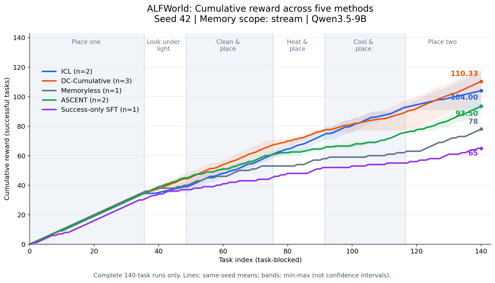

# 五种方法的累计 reward：seed 42 / stream

补充：[各阶段完成结果柱状图](five_methods_stage_results.md)。

比较上下文为 Qwen3.5-9B、valid_seen、seed 42、task_blocked、memory_scope=stream、admissible、最多 50 步。五种方法的 140 个 episode ID、task_type 和任务顺序已逐条核对一致。ASCENT 使用本地两次完整运行的原始 traces，按每个任务位置计算累计成功次数均值与 min–max 阴影。横轴为任务序号，纵轴为已完成任务的 reward 累积；reward 为 0/1，所以也等于累计成功任务数。

| 方法 | 完整运行数 | 各次最终 reward | 图中最终值 | 成功率 |
|---|---:|---|---:|---:|
| ICL | 2 | 91, 117 | 104.00 | 74.29% |
| DC-Cumulative | 3 | 98, 119, 114 | 110.33 | 78.81% |
| Memoryless | 1 | 78 | 78.00 | 55.71% |
| ASCENT | 2 | 89, 98 | 93.50 | 66.79% |
| Success-only SFT | 1 | 65 | 65.00 | 46.43% |

## SFT 更新数据来源

Success-only SFT 的最终累计 reward 为 65（46.43%）。实际更新的 987 条样本中，简单放置占 32.93%，双物体占 19.66%，加热占 17.43%，三者合计 70.01%；冷却仅占 4.76%。[详细任务类型、目标 token 和 optimizer steps 分析](success_only_sft_training_sources.md)。

## 选取口径

- ICL、DC 延续前一张图：只取 stream 的完整运行；同 seed 多次重复按每个任务位置求均值。阴影为这些重复的 min–max，不是置信区间。ICL repeat 1 只完成 69 局，被排除。
- Memoryless 使用 `report/memoryless_and_ascent/instances.csv` 中 seed 42 的 140 条记录；不混入 seed 43/44 或 shuffled 结果。
- ASCENT 使用 `runs/ascent-task_blocked-seed42-20261103T070526Z/run1` 和 `run2`，只读取 `commit.json` 引用的已完成 attempts；逐局核对 `episode.json` 与 commit 的 ID、类型、位置、success、score，并与 summary 汇总交叉验证。两次均为 seed 42 / stream / task_blocked，成功总数为 89、98，平均 93.5（66.79%）。280 条逐任务 reward 保存在 `ascent_trace_instances.csv`，原始配置与文件哈希保存在 `ascent_trace_provenance.json`。
- Success-only SFT 使用本机 GPU 2 单卡正式运行的 140 条已提交结果，batch_size=2、梯度累积=4、训练样本长度上限=4096、历史窗口为之前 5 次交互；没有把试跑或双卡诊断加入曲线。
- Memoryless 的 stream 标签表示同一连续任务流；它本身不保存跨局记忆。
- Memoryless 的原始运行目录当前不在本机，读取仓库逐实例快照和原始 commit 哈希；对其配置的描述依据已有报告。ASCENT 已核对本地原始配置，其两次运行均值替换此前单次 75/140 的结果。
- 不同方法来自不同批次，未证明提示词、软件版本及所有其他设置完全相同。该图是现有结果趋势的对照，不是严格控制全部变量的多 seed 因果实验；n 不同也不能据此作显著性声明。

## 文件

- [PNG](five_methods_seed42_stream.png) / [PDF](five_methods_seed42_stream.pdf) / [SVG](five_methods_seed42_stream.svg)
- [五种方法的逐任务 CSV](five_methods_seed42_stream.csv) / [ASCENT 阶段末累计数据](ascent_stage_cumulative.csv) / [ASCENT 逐任务快照](ascent_trace_instances.csv) / [ASCENT traces 来源](ascent_trace_provenance.json)
- [来源与哈希](five_methods_seed42_stream_provenance.json)
- [生成脚本](plot_five_methods.py)：`python3 report/icl+dc/plot_five_methods.py`，仅依赖仓库内快照，无需原始 runs/。如需从本地 traces 重新导出 ASCENT，先运行 `python3 report/icl+dc/export_ascent_traces.py`。
