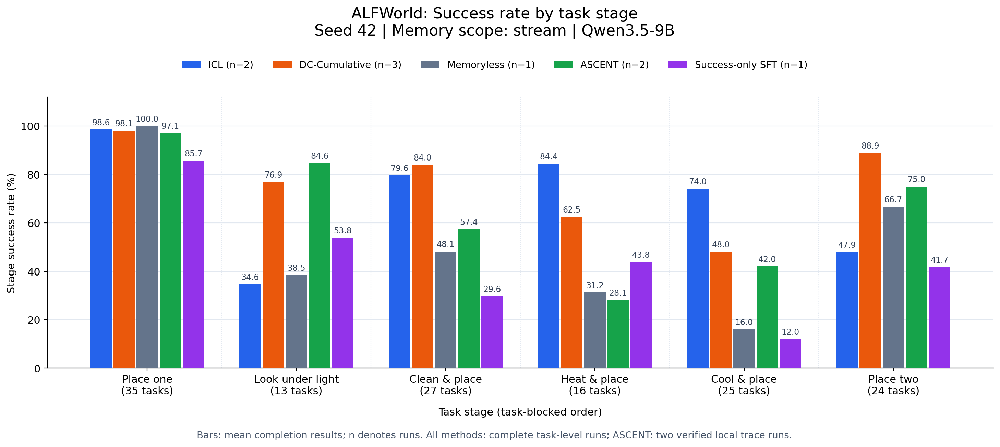
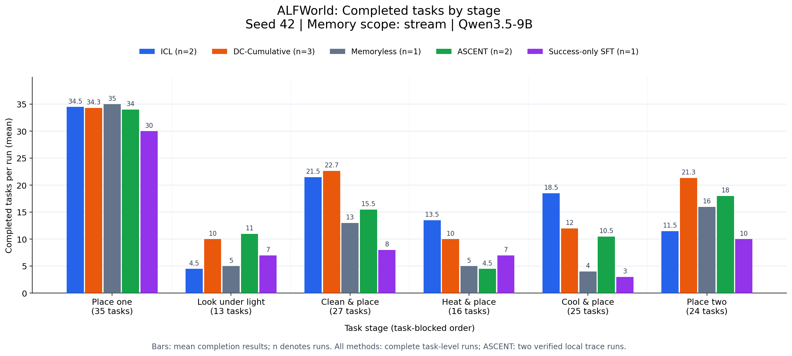

# 五种方法的阶段完成结果

对应[五方法累计 reward 图](five_methods_seed42_stream.md)：ICL 2 次、DC 3 次、Memoryless/SFT 各 1 次。ASCENT 使用两次本地完整 traces（Run 1=89、Run 2=98），替换此前单次 75/140 的数据。原始 config 已核对为 seed 42 / stream / task_blocked，逐任务 ID 与其他方法一致。

## 阶段成功率

每组柱对应一个任务阶段；纵轴是该阶段的成功率，不是截至该阶段的累计成功率。阶段长度不同（35/13/27/16/25/24），所以成功率更适合跨阶段比较。图例与标注均为英文，n 为完整运行次数。

| 阶段 | ICL | DC-Cumulative | Memoryless | ASCENT | Success-only SFT |
|---|---:|---:|---:|---:|---:|
| 简单放置 | 34.50/35（98.6%） | 34.33/35（98.1%） | 35.00/35（100.0%） | 34.00/35（97.1%） | 30.00/35（85.7%） |
| 灯下查看 | 4.50/13（34.6%） | 10.00/13（76.9%） | 5.00/13（38.5%） | 11.00/13（84.6%） | 7.00/13（53.8%） |
| 清洗后放置 | 21.50/27（79.6%） | 22.67/27（84.0%） | 13.00/27（48.1%） | 15.50/27（57.4%） | 8.00/27（29.6%） |
| 加热后放置 | 13.50/16（84.4%） | 10.00/16（62.5%） | 5.00/16（31.2%） | 4.50/16（28.1%） | 7.00/16（43.8%） |
| 冷却后放置 | 18.50/25（74.0%） | 12.00/25（48.0%） | 4.00/25（16.0%） | 10.50/25（42.0%） | 3.00/25（12.0%） |
| 双物体放置 | 11.50/24（47.9%） | 21.33/24（88.9%） | 16.00/24（66.7%） | 18.00/24（75.0%） | 10.00/24（41.7%） |

表格中分子为每次运行平均完成任务数，分母为每次运行该阶段的任务数；均值可以是小数。所有重复均为 seed 42。ASCENT 的两次运行以 commit.json 选定的原始 episode traces 为来源。

## 阶段完成数量

这张图直接显示各阶段平均完成了多少任务；各阶段值相加，分别等于原累计曲线终点：ICL 104.00、DC 110.33、Memoryless 78、ASCENT 93.5、SFT 65。所有方法逐运行验证阶段成功数等于对应累计 reward 差值；ASCENT 同样使用逐任务真实结果。

## 文件与口径

- [成功率 PNG](five_methods_stage_success_rate.png) / [PDF](five_methods_stage_success_rate.pdf) / [SVG](five_methods_stage_success_rate.svg)。
- [完成数量 PNG](five_methods_stage_completed_tasks.png) / [PDF](five_methods_stage_completed_tasks.pdf) / [SVG](five_methods_stage_completed_tasks.svg)。
- [阶段统计 CSV](five_methods_stage_results.csv) / [绘图脚本](plot_stage_bars.py)。
- 运行 `python3 report/icl+dc/plot_stage_bars.py`，只需已提交的合并 CSV 与 provenance，无需原始 runs/。
- 与原趋势图相同：不同方法来自不同批次、重复次数不同，这些柱状图描述现有结果，不构成控制所有变量的显著性或因果结论。

五种方法 CSV SHA256：`459e5f1f52e4cf490ca50b003cc73f542da6626060d1506ec3b4e70b838400a2`。

ASCENT 逐任务快照 SHA256：`2cdaae6394604969f4c0e69364298bf2f1b86a14309546a9ea6b89af26f42b6f`。
