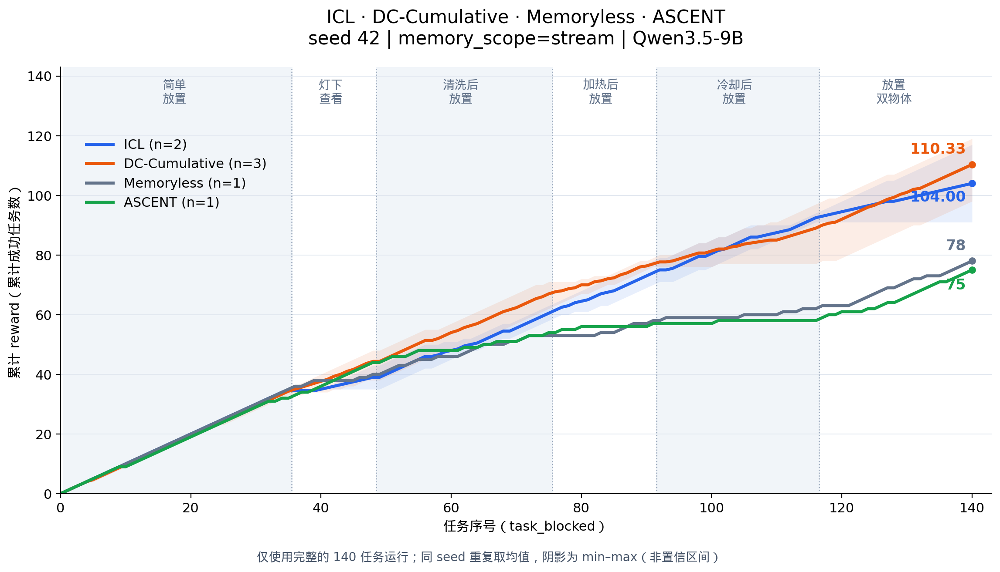

# 四种方法的累计 reward：seed 42 / stream

共同条件为 Qwen3.5-9B、valid_seen、seed 42、task_blocked、memory_scope=stream、admissible、最多 50 步。逐条核对四种方法的 episode ID 和 task_type，140 个任务的顺序完全一致。横轴为任务序号，纵轴为已完成任务的 reward 累积；reward 为 0/1，所以也等于累计成功任务数。

| 方法 | 完整运行数 | 各次最终 reward | 图中最终值 | 成功率 |
|---|---:|---|---:|---:|
| ICL | 2 | 91, 117 | 104.00 | 74.29% |
| DC-Cumulative | 3 | 98, 119, 114 | 110.33 | 78.81% |
| Memoryless | 1 | 78 | 78.00 | 55.71% |
| ASCENT | 1 | 75 | 75.00 | 53.57% |

## 选取口径

- ICL、DC 延续前一张图：只取 stream 的完整运行；同 seed 多次重复按每个任务位置求均值。阴影为这些重复的 min–max，不是置信区间。ICL repeat 1 只完成 69 局，被排除。
- Memoryless、ASCENT 使用 `report/memoryless_and_ascent/instances.csv` 中 seed 42 的各 140 条记录；不混入 seed 43/44，也不使用本机旧 shuffled Memoryless 的 84/140 结果。
- Memoryless 的 stream 标签表示同一连续任务流；它本身不保存跨局记忆。
- Memoryless 和 ASCENT 的原始运行目录当前不在本机，本图读取仓库内已有的逐实例快照和原始 commit 哈希；对其配置的描述依据已有来源报告，不能在本机重新核对完整原始 config。逐实例 reward 与任务顺序已从 CSV 独立验证。
- 不同方法来自不同批次，未证明提示词、软件版本及所有其他设置完全相同。该图是现有结果趋势的对照，不是严格控制全部变量的多 seed 因果实验；n 不同也不能据此作显著性声明。

## 文件

- [PNG](four_methods_seed42_stream.png) / [PDF](four_methods_seed42_stream.pdf) / [SVG](four_methods_seed42_stream.svg)
- [合并后的逐任务 CSV](four_methods_seed42_stream.csv)
- [来源与哈希](four_methods_seed42_stream_provenance.json)
- [生成脚本](plot_four_methods.py)：`python3 report/icl+dc/plot_four_methods.py`，仅依赖仓库内快照，无需原始 runs/。
