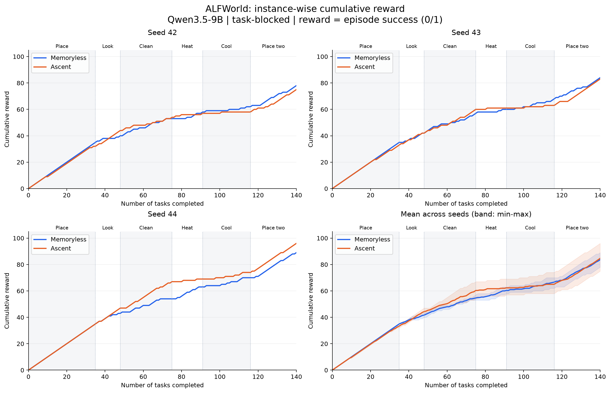
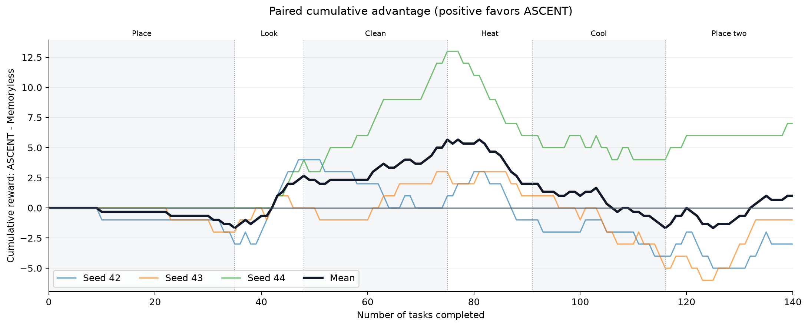
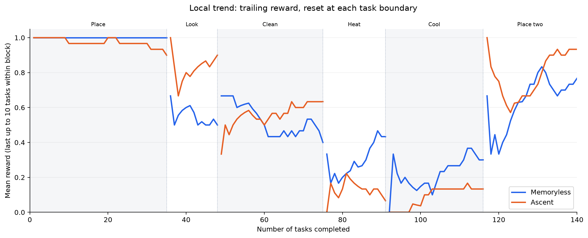

# Memoryless 与 ASCENT：逐实例持续学习趋势

数据：三个 seed（42、43、44），每次 140 个任务；Qwen3.5-9B，valid_seen，task_blocked，admissible，最多 50 步。ASCENT 的参数跨任务类别保留（memory_scope=stream）。本报告仅分析 `blocked-memoryless-3runs-20261102` 与 `blocked-ascent-3runs-20261102`，不混用其他批次或旧报告的数据。

## 统计口径

仅取 `commit.json.completed` 的已提交记录，按 position 排序；恢复产生的废弃尝试不重复统计。脚本验证同 seed 的两种方法具有相同 manifest 和逐实例 episode ID 顺序，且六次运行全部完成。reward 使用记录中的 episode score；本批次所有 score 均为 0/1，且等于成功标记。因此累积 reward 就是截至该位置成功完成的任务数：R(n)=Σᵢ₌₁ⁿ rᵢ。横轴是流中已完成的任务数量，不是训练 step。

## 逐实例累积 reward



每个点对应一个任务，未经平滑。右下图为三个 seed 的逐位置均值，阴影为 seed 最小值到最大值，并非置信区间。不同 seed 的块内实例顺序不同，均值表示相同流位置的平均结果。

| Seed | Memoryless reward | ASCENT reward | ASCENT − Memoryless |
|---|---:|---:|---:|
| 42 | 78 | 75 | -3 |
| 43 | 84 | 83 | -1 |
| 44 | 89 | 96 | +7 |
| 平均 | 83.67 | 84.67 | +1.00 |

平均最终成功率为 Memoryless **59.76%**、ASCENT **60.48%**，差 **+0.71 个百分点**（三个流合计多成功 3 局）。Seed 42、43 的 ASCENT 略低，seed 44 更高，因此总体提升不稳定。

## 相对基线的累积优势



该图在相同任务位置相减，比单独观察单调上升的累积曲线更容易判断优势是否随经验积累扩大。正值表示 ASCENT 领先。

| 类别（任务位置） | Memoryless 成功率 | ASCENT 成功率 | 块内平均 reward 差 | 块末平均累积差 |
|---|---:|---:|---:|---:|
| 简单放置（1–35） | 100.00% | 95.24% | -1.67 | -1.67 |
| 灯下查看（36–48） | 51.28% | 84.62% | +4.33 | +2.67 |
| 清洗（49–75） | 48.15% | 59.26% | +3.00 | +5.67 |
| 加热（76–91） | 35.42% | 12.50% | -3.67 | +2.00 |
| 冷却（92–116） | 25.33% | 10.67% | -3.67 | -1.67 |
| 放置两个物体（117–140） | 70.83% | 81.94% | +2.67 | +1.00 |

ASCENT 的平均累积优势在灯下查看和清洗阶段扩大，但在加热、冷却阶段回落，最后在放置两个物体阶段重新追回。优势没有随任务数量持续扩大；曲线主要呈现明显的任务类别依赖。

## 局部趋势与解释边界



辅助图展示最近最多 10 个任务的平均 reward，先在每个 seed 内计算，再跨 seed 平均；窗口在类别边界清空，起始不足 10 个任务时使用已有任务。它近似反映累积曲线的局部斜率，不替代主图的原始逐实例数据。

- 累积 reward 必然不下降，因此曲线上升本身不代表学会了更多；应比较斜率及相对 Memoryless 的差值。
- 类别顺序固定，任务难度分布随位置改变。后半程斜率变化不能单独归因于持续学习或遗忘。
- 当前是在线适应成绩：本局先计分，ASCENT 更新只影响后续局。没有周期性重测早期任务，因此不能直接测量灾难性遗忘；也不能从这三条流证明稳定的正向迁移。
- 同一批 140 个游戏被三个 seed 重排，420 次结果并非 420 个独立任务；未作独立样本显著性声明。

## 复现与文件

安装 numpy、matplotlib 后，在仓库根目录执行：

```bash
.venv/bin/python report/memoryless_and_ascent/analyze.py
# 无原始 runs 时，使用已保存的逐实例数据：
.venv/bin/python report/memoryless_and_ascent/analyze.py --from-csv
```

`instances.csv` 保存 840 条逐实例记录及 attempt 路径；`provenance.json` 保存原始 commit 文件路径和 SHA256。每张图提供 PNG、PDF、SVG。
