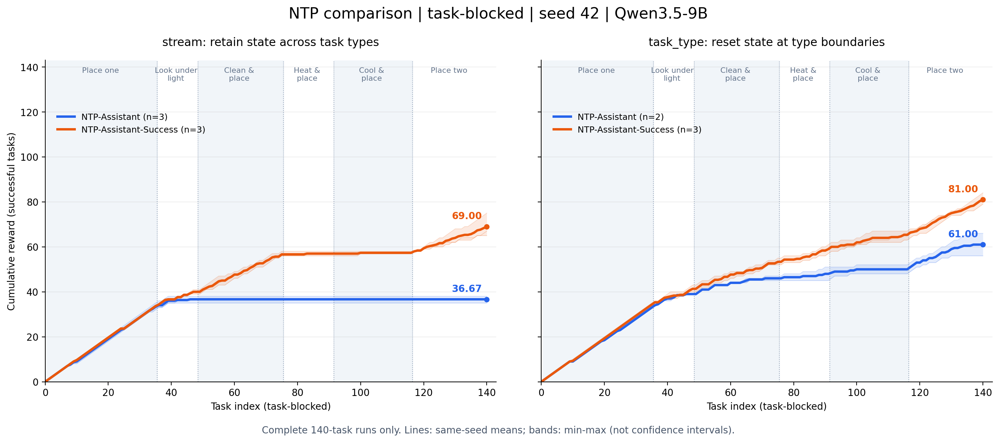

# NTP-Assistant 与 NTP-Assistant-Success：task_blocked 趋势

`task_blocked` 是任务顺序，`stream` 是记忆范围，两者不是互斥配置。本报告固定 task_blocked + seed 42，比较 stream（跨类型保留状态）与 task_type（类型边界重置）的两种 NTP 方法。

横轴是同一份 manifest 的任务序号 1–140，纵轴为已提交 episode 的终局 score 累加。已核对 score=success，均为 0/1。只取完整运行求均值；同 seed 的重复不是不同 seed。

## 完整结果

| 方法 | 记忆范围 | 完成次数 | 各次最终 reward | 平均累计 reward | 成功率 |
|---|---|---:|---|---:|---:|
| NTP-Assistant | stream | 3/3 | r1=35, r2=38, r3=37 | 36.67 | 26.19% |
| NTP-Assistant-Success | stream | 3/3 | r1=67, r2=75, r3=65 | 69.00 | 49.29% |
| NTP-Assistant | task_type | 2/3 | r1=66, r3=56 | 61.00 | 43.57% |
| NTP-Assistant-Success | task_type | 3/3 | r1=79, r2=84, r3=80 | 81.00 | 57.86% |

## 趋势解读

- **task_blocked + stream：** 普通 NTP 在前两个任务块后基本进入平台，最终均值 36.67；success-only 版本后面仍有增益，最终均值 69.00，增加 32.33 个成功任务（23.10 个百分点）。

- **task_blocked + task_type：** 重置后普通 NTP 在后续类型上也能继续积累 reward，最终均值 61.00；success-only 版本为 81.00，增加 20 个任务（14.29 个百分点）。

- 从 stream 改成 task_type，普通 NTP 均值增加 24.33（17.38 个百分点），success-only 增加 12.00（8.57 个百分点）。但普通 NTP 的 task_type 只有 2 次完成，不能将该差值视为严格的因果效应。

- task_type 中双方共同完整运行的 repeat 为 1、3：普通 NTP 均值 61.00，success-only 为 79.50，差 18.50（13.21 个百分点）；不依赖 success-only 的额外 repeat 2，优势方向仍相同。

- 固定类型顺序会把任务难度与训练时间混合；累计曲线必然不下降，曲线上升本身不代表迁移能力提升。本批次没有不同 seed 的独立重复。

## 各任务块成功率

每格合并该组完整运行，分母随完成次数而异。

| 任务类型 | NTP / stream | NTP-Success / stream | NTP / task_type | NTP-Success / task_type |
|---|---:|---:|---:|---:|
| 简单放置 | 100/105（95.2%） | 101/105（96.2%） | 66/70（94.3%） | 103/105（98.1%） |
| 灯下查看 | 10/39（25.6%） | 19/39（48.7%） | 12/26（46.2%） | 21/39（53.8%） |
| 清洗后放置 | 0/81（0.0%） | 50/81（61.7%） | 14/54（25.9%） | 36/81（44.4%） |
| 加热后放置 | 0/48（0.0%） | 1/48（2.1%） | 4/32（12.5%） | 17/48（35.4%） |
| 冷却后放置 | 0/75（0.0%） | 1/75（1.3%） | 4/50（8.0%） | 19/75（25.3%） |
| 双物体放置 | 0/72（0.0%） | 35/72（48.6%） | 22/48（45.8%） | 47/72（65.3%） |

## 失败表现

| 方法 / 范围 | 尝试数 | 格式错误（占尝试） | 非法动作（占尝试） | 零环境调用局数 |
|---|---:|---:|---:|---:|
| NTP-Assistant / stream | 16582 | 8251（49.76%） | 5761（34.74%） | 163 |
| NTP-Assistant-Success / stream | 13437 | 300（2.23%） | 3165（23.55%） | 0 |
| NTP-Assistant / task_type | 9735 | 63（0.65%） | 2216（22.76%） | 0 |
| NTP-Assistant-Success / task_type | 12973 | 103（0.79%） | 890（6.86%） | 0 |

普通 NTP / stream 的 repeat 1、2 分别有 80、83 局完全没有环境调用；repeat 3 没有这种格式崩溃，但 5484 次尝试中有 4673 次非法动作。因此不同重复的直接失败模式并不完全相同。success-only 的 stream 三次均无零调用局，但仍有大量非法动作，加热和冷却也很弱。

这些都是旧 NTP 实现的结果：assistant-only body 标签、不监督模板外 EOS、训练/生成前缀不一致，以及整段 transcript 的 token 分块等问题见[此前审计](../2026-11-04-ntp-error-analysis.md)。success-only 只筛选成功 episode，并不逐步过滤其中的错误输出。不能用这批结果概括所有 NTP 实现；也不能将它与后来手工构造样本、带 EOS 监督的 success-only-sft 混为同一种方法。

## 未完成项与文件

`history-ntp-assistant-task_type-2` 在 0/140 局时因 cuDNN/CUDA 错误失败，未纳入均值。其余 11 次均已完整完成；先前还在运行的 stream repeat 1、2 的结果已更新到最终 140 局。

[PNG](task_blocked_trends.png) / [PDF](task_blocked_trends.pdf) / [SVG](task_blocked_trends.svg) · [逐任务 CSV](instances.csv) · [统计快照](snapshot.json) · [生成脚本](analyze.py)
